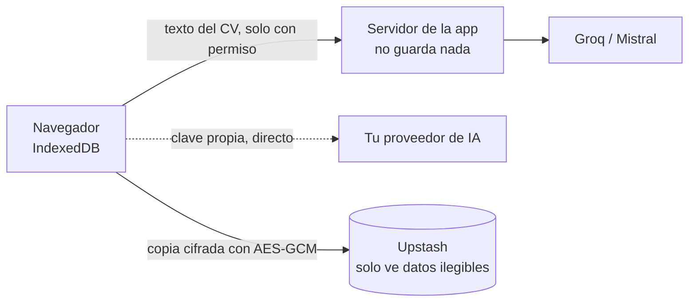

# Buscador de ofertas

Sube tu CV, cuéntale qué buscas y la IA puntúa las ofertas de trabajo según lo bien que encajan contigo. Hecho con Next.js, TypeScript y una idea fija: **tus datos se quedan en tu navegador**.

## Qué hace

1. **Ajustes**: eliges la IA. O la de la app (Groq, con Mistral de reserva) o tu propia clave de cualquier API compatible con OpenAI. Un botón «Probar conexión» comprueba que funciona y explica el fallo (clave, cupo, modelo, CORS).
2. **Perfil**: subes tu CV en PDF. El texto se extrae en el navegador, y solo se envía a la IA después de que aceptes. Revisas y corriges el perfil resultante y fijas tus preferencias (puestos, ubicación, remoto, sectores a evitar).
3. **Ofertas**: busca en Remotive, Adzuna y Jooble (o importa una oferta por enlace, o añádela a mano), quita duplicados y puntúa cada oferta de 0 a 100 diciendo qué cumples y qué te falta.
4. **Candidaturas**: guarda ofertas, sigue su estado, anota y genera una carta de presentación que luego editas.
5. **Copia**: copia cifrada en la nube con alias y contraseña, para recuperar tus datos si borras el navegador. Si hay datos y pasan 14 días sin copia, un aviso lo recuerda (se puede posponer 7 días). Cuando hay datos, la app también pide al navegador almacenamiento persistente para que no los borre por falta de espacio.

## Privacidad: cómo está resuelta



- No hay cuentas ni base de datos con datos personales. Perfil, ofertas, notas y cartas viven en IndexedDB.
- El servidor de la IA solo reenvía la petición. No registra ni guarda el contenido.
- Con clave propia, la clave se guarda solo en tu navegador y las llamadas van directas a tu proveedor sin pasar por el servidor.
- La copia en la nube se cifra **en el navegador**: PBKDF2 (600 000 iteraciones) de tu contraseña, HKDF para sacar dos claves independientes (una para AES-GCM y otra para demostrar que eres el dueño de la copia), y el servidor solo guarda el blob cifrado y el hash del token. Tu clave de IA no entra en la copia.
- **Sin la contraseña no hay recuperación.** Nadie puede restablecerla, y es lo que hace que el servidor no pueda leer nada.
- Importar por enlace obliga al servidor a descargar páginas ajenas, así que se defiende de SSRF: solo http/https en los puertos 80 y 443, sin credenciales en la URL, la IP **real** a la que conecta (no solo el nombre) tiene que ser pública, cada redirección (máx. 3) se revalida, y hay límite de 8 s y 1 MB y solo se acepta HTML. No se guarda nada: la página se descarga, se extrae la oferta y se devuelve al navegador.
- CSP sin recursos de terceros: ni scripts, ni fuentes, ni analítica.

## Decisiones

| Decisión                                     | Motivo                                                                                                                                                                         |
| -------------------------------------------- | ------------------------------------------------------------------------------------------------------------------------------------------------------------------------------ |
| Datos en el navegador (Dexie / IndexedDB)    | Privacidad sin coste de servidor ni cuentas.                                                                                                                                   |
| IA obligatoria, con dos vías                 | Leer un CV y puntuar encajes sin IA daría un resultado pobre. La clave propia permite no depender de la cuota gratuita.                                                        |
| Texto de CV y ofertas como datos, no órdenes | Tanto el CV como las ofertas vienen de terceros. Van como mensaje de usuario, el prompt de sistema avisa de que son datos y la respuesta se valida con Zod (con un reintento). |
| Sin scraping de LinkedIn                     | Va contra sus condiciones. Se usan APIs que lo permiten.                                                                                                                       |
| Puntuar de una en una                        | La IA gratuita tiene límite por minuto; así un fallo no pierde lo ya puntuado.                                                                                                 |
| `unsafe-inline` en `script-src`              | Next lo necesita para arrancar páginas estáticas. Una CSP con nonce obligaría a renderizar todo en el servidor; se prefirió mantener las páginas estáticas.                    |
| `connect-src` abierto a `https:` y localhost | La persona puede usar su propia IA (OpenAI, Ollama en local...) y no se sabe a qué host.                                                                                       |

## Stack

Next.js 16 (App Router), React 19, TypeScript, Tailwind 4, Dexie, Zod, pdf.js, Web Crypto, Upstash Redis (límites de uso y copias cifradas). Vitest y fake-indexeddb para los tests.

## Puesta en marcha

```bash
npm ci
cp .env.example .env.local   # rellena lo que vayas a usar
npm run dev
```

Variables (todas están en `.env.example`):

- `GROQ_API_KEY` y/o `MISTRAL_API_KEY`: IA de la app. Con al menos una basta; si Groq falla o se llena, pasa a Mistral.
- `UPSTASH_REDIS_REST_URL` y `UPSTASH_REDIS_REST_TOKEN`: límite por persona y copia en la nube. Obligatorias en producción; sin ellas la IA de la app y la copia responden 503.
- `ADZUNA_APP_ID`, `ADZUNA_APP_KEY`, `ADZUNA_PAIS`, `JOOBLE_API_KEY`: fuentes de ofertas opcionales. Remotive no necesita clave y solo busca ofertas remotas.

**Modo demo**: el botón «Probar con datos de ejemplo» de la portada carga un perfil y unas ofertas inventadas y pone la IA en modo demo, que responde con textos de ejemplo sin red. Sirve para enseñar la app sin CV ni claves.

Sin ninguna clave de servidor puedes usar la app igualmente con tu propia clave de IA y Remotive.

## Calidad

```bash
npm test            # Vitest
npm run lint
npm run format:check
npm run typecheck
npm run build
npm run e2e          # Playwright contra la app compilada (hace falta `npm run build` antes)
```

En local, si ya tienes un Chromium, `PW_CHROMIUM=/ruta/al/chrome npm run e2e` evita descargar el de Playwright. La CI ejecuta todo esto en cada PR. Los commits siguen Conventional Commits.

## Qué no está verificado

Se prueba con respuestas simuladas, no contra los servicios reales:

- Groq, Mistral y las APIs de Adzuna, Jooble y Remotive.
- La calidad de las notas y de las cartas con un modelo real.
- Upstash (límites y copias).
- PDFs de CV reales y variados: se probó con uno sencillo.

## Pendiente

- Probar con claves reales y desplegar en Vercel.

## Licencia

MIT. Ver [LICENSE](LICENSE).
